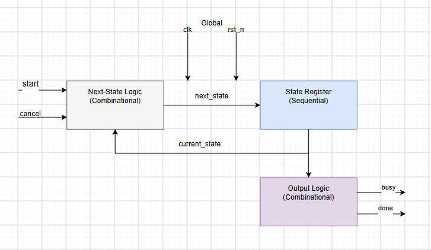

# Task 15: Multi-Input, Multi-Output FSM (Moore Machine)

## Overview
This project contains the SystemVerilog RTL design and verification environment for a Multi-Input, Multi-Output (MIMO) Finite State Machine. The module models a simple request-processing controller, transitioning between IDLE, processing (BUSY), and completion (DONE) states based on `start` and `cancel` inputs. It is implemented using the industry-standard **3-block coding style** for clear separation of sequential and combinational logic.

## Directory Structure
*   **`rtl/`**: Contains the SystemVerilog design module.
    *   `MIMO_FSM.sv`: The Moore FSM RTL implementation using three distinct blocks.
*   **`tb/`**: Contains the testbench file for functional verification.
    *   `tb_MIMO_FSM.sv`: Stimulus and verification environment covering all primary sequences.
*   **`figures/`**: Contains architectural diagrams (`.drawio`, `.png`), hand-drawn state diagrams (`.jpeg`), terminal logs, and waveform screenshots[cite: 13].

## Design Architecture
The FSM is designed as a strict **Moore Machine**, meaning its outputs (`busy`, `done`) depend exclusively on the current state. The inputs (`start`, `cancel`) only influence state transitions, not the outputs directly. 

The design is split into three distinct hardware blocks:
1.  **State Register (Sequential):** Updates the `current_state` to the `next_state` on the active clock edge.
2.  **Next-State Logic (Combinational):** Evaluates `start` and `cancel` to determine state routing (e.g., IDLE → BUSY_1 → BUSY_2 → DONE, or aborting to IDLE).
3.  **Output Logic (Combinational):** Asserts the `busy` and `done` flags purely based on the active `current_state`.

**State Derivation & Architecture Diagrams:**

   **State Transition Diagram:** 
   
   **3-Block Architecture:** 

## Verification & Simulation Results
The testbench (`tb_MIMO_FSM.sv`) verifies the FSM by driving the clock and applying specific input sequences to test both normal operation and edge cases. It explicitly checks for:
*   A complete processing sequence: `IDLE` → `start` → `BUSY` → `DONE` → `IDLE`.
*   An aborted processing sequence: `IDLE` → `start` → `BUSY` → `cancel` → `IDLE` (without asserting `done`).

### Terminal Output
The testbench logs the cycle-by-cycle state changes and output flags to the terminal, confirming that the FSM successfully processes requests and handles mid-cycle cancellations appropriately.

   **Terminal Log:** 

### Waveform Analysis
Simulation timing was evaluated using a waveform viewer. The timing diagram visually confirms that the 3-block style successfully prevents glitches, state transitions happen synchronously on the clock edge, and outputs align perfectly with the active states.

   **Simulation Waveform:** 