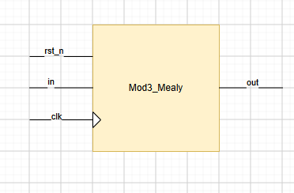

# Task 16: Mealy Finite State Machine (FSM)

## Overview
This project contains the SystemVerilog RTL design and verification environment for a Mealy Finite State Machine. It explores the key architectural difference between Moore and Mealy machines: in a Mealy FSM, the outputs depend not only on the current state but also directly on the current inputs. This allows the FSM to react to input changes asynchronously within the same clock cycle.

## Directory Structure
*   **`rtl/`**: Contains the SystemVerilog design module.
    *   `Mealy_FSM.sv`: The Mealy FSM RTL implementation.
*   **`tb/`**: Contains the testbench file for functional verification.
    *   `tb_Mealy_FSM.sv`: Stimulus and verification environment.
*   **`figures/`**: Contains architectural diagrams (`.drawio`, `.png`), hand-drawn state derivations (`.jpeg`), terminal logs, and waveform screenshots[cite: 14].

## Design Architecture
The design models a state-based controller using the Mealy architecture. Because the outputs are a function of both the current state and the inputs, the combinational output logic block takes external inputs directly. This often results in fewer states than an equivalent Moore machine but requires careful timing analysis to avoid combinational logic loops or glitches.

**State Derivation & Architecture Diagrams:**

   **State Transition Diagram:** 

   **Architecture Diagram:** 

## Verification & Simulation Results
The testbench (`tb_Mealy_FSM.sv`) verifies the FSM by applying input sequences that trigger specific state transitions. Crucially, it monitors the outputs to ensure they update immediately upon an input change (combinational behavior) rather than waiting for the next active clock edge.

### Terminal Output
The testbench logs the inputs, current state, next state, and outputs to the terminal, confirming that the state routing and output logic operate correctly under various input conditions.

  **Terminal Log:** 

### Waveform Analysis
Simulation timing was evaluated using a waveform viewer. The timing diagram visually confirms the defining characteristic of a Mealy machine: the outputs can change asynchronously mid-cycle if the input changes, while the actual state transitions remain perfectly synchronous to the clock edges.

   **Simulation Waveform:** 