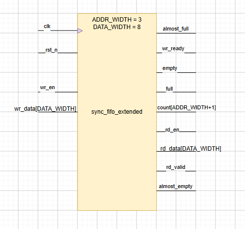

# Task 18: Extended Synchronous FIFO

## Overview
This project builds upon the foundational synchronous FIFO design by implementing extended control features and advanced state management. Extended FIFOs typically incorporate additional capabilities such as programmable watermarks (dynamic almost-full/almost-empty thresholds), a flush/clear mechanism for rapid reset, or peek/pass-through logic to support more complex data buffering and system synchronization requirements.

## Directory Structure
*   **`rtl/`**: Contains the SystemVerilog design module.
    *   `fifo_extension.sv`: The extended FIFO RTL implementation.
*   **`tb/`**: Contains the testbench file for functional verification.
    *   `tb_extended_fifo.sv`: A robust testbench designed to verify both the standard FIFO operations and the newly added extended features.
*   **`figures/`**: Contains architectural diagrams (`.drawio`, `.png`), terminal logs, and waveform screenshots[cite: 16].

## Design Architecture
The design (`fifo_extension.sv`) retains the core 2D memory array and dual-pointer logic of a standard FIFO but wraps it with additional combinational and sequential logic. This extended architecture allows the buffering system to handle edge cases more gracefully and provides the surrounding system with higher-granularity status information to prevent data bottlenecks.

**Architecture Diagram:**
   

## Verification & Simulation Results
The testbench (`tb_extended_fifo.sv`) applies a rigorous sequence of directed tests. In addition to standard overflow and underflow protection, it actively verifies the extended features (such as testing dynamic threshold assertions or ensuring a clear signal properly flushes the internal pointers without corrupting future writes).

### Terminal Output
The testbench logs operations and flag statuses to the terminal, confirming that the extended control signals behave correctly under heavy read/write traffic.

   **Terminal Log:** 

### Waveform Analysis
Simulation timing was evaluated using a waveform viewer. The timing diagram visually confirms the stability of the memory array and the precise clock-cycle alignment of the new extended flags and control signals.

   **Simulation Waveform:** 