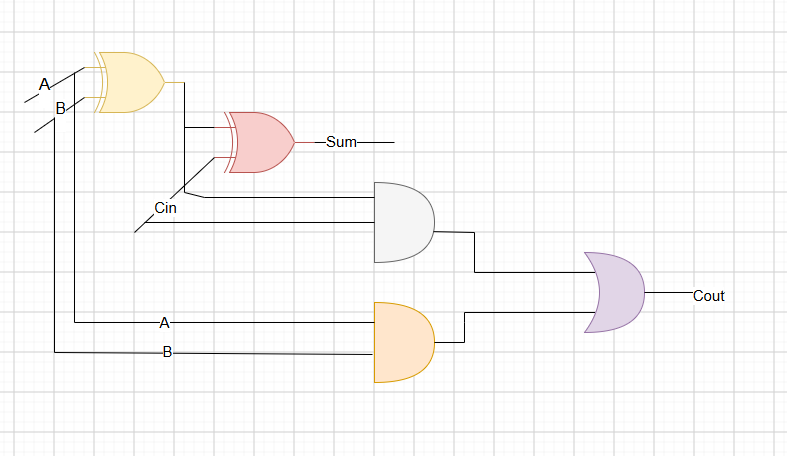
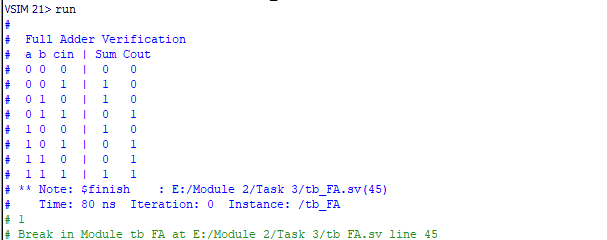
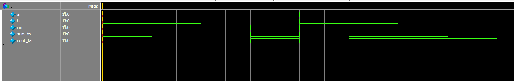
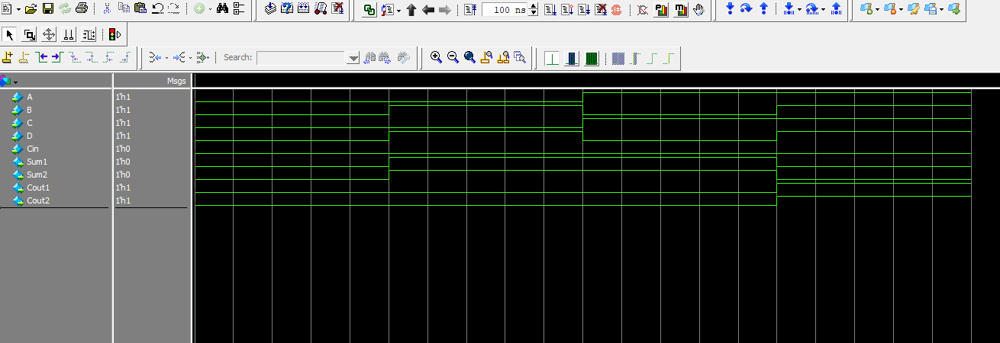

# Task 3: Half Adder and Full Adder Implementation

## Overview
This project contains the SystemVerilog RTL design and verification environment for standard digital adder circuits. It implements a foundational Half Adder (HA) and a hierarchical Full Adder (FA) constructed by cascading two Half Adders. 

## Directory Structure
*   **`rtl/`**: Contains the SystemVerilog design modules.
    *   `HA.sv`: Half Adder implementation.
    *   `FA.sv`: Full Adder implementation (hierarchically instantiating `HA.sv`).
*   **`tb/`**: Contains the testbench files for functional verification.
    *   `tb_HA.sv`: Stimulus and verification for the Half Adder.
    *   `tb_FA.sv`: Stimulus and verification for the Full Adder.
*   **`figures/`**: Contains structural diagrams (`.drawio`, `.png`), terminal logs, and waveform screenshots[cite: 1].

## Design Architecture

### 1. Half Adder (`HA.sv`)
A fundamental combinational circuit that adds two 1-bit binary inputs, producing a `Sum` and a `Carry` output.

### 2. Full Adder (`FA.sv`)
A hierarchical design that adds three 1-bit inputs (A, B, and Carry-In). As illustrated in the structural diagrams, it is built by wiring together two instances of the Half Adder module along with additional combinational logic to compute the final `Sum` and `Carry-Out`.

**Architecture Diagrams:**
  

## Verification & Simulation Results
The testbenches apply a complete sweep of input vectors to verify the truth tables of both the Half Adder and Full Adder. 

### Terminal Output
The testbenches automatically monitor the input changes and log the expected vs. actual results to the terminal.

   **Half Adder Log:** 
  **Full Adder Log:** 

### Waveform Analysis
Simulation timing and signal transitions were verified using a waveform viewer to ensure correct combinational propagation.

 **Full Adder Waveform:** 

  **Two Half Adders Waveform:** 
