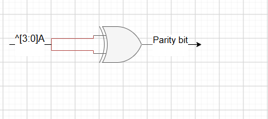

# Task 5: Parity Logic Implementation

## Overview
This project contains the SystemVerilog RTL design and verification environment for a parity generator/checker circuit. It serves as a practical exercise in combinational logic design commonly used for basic error detection in digital data transmission.

## Directory Structure
*   **`rtl/`**: Contains the SystemVerilog design module.
    *   `Parity.sv`: The parity logic RTL implementation.
*   **`tb/`**: Contains the testbench file for functional verification.
    *   `tb.sv`: Stimulus and verification environment.
*   **`figures/`**: Contains the architectural diagrams (`.drawio`, `.png`), terminal logs, and waveform screenshots[cite: 3].

## Design Architecture
The design consists of a single module (`Parity.sv`) that computes the parity (even or odd) of a given input data vector, typically implemented using a cascade or tree of XOR/XNOR logic gates.

**Architecture Diagram:**
  

## Verification & Simulation Results
The testbench (`tb.sv`) applies a comprehensive sweep of input vectors to verify the correct combinational behavior of the parity calculation. 

### Terminal Output
The testbench automatically monitors the input changes and logs the results to the terminal to confirm the output matches the expected parity truth table.

   **Terminal Log:** 

### Waveform Analysis
Simulation timing and signal transitions were evaluated using a waveform viewer to ensure accurate gate-level logic propagation.

 **Simulation Waveform:** 