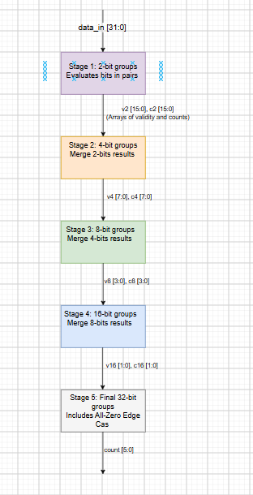

# Task 7: 32-bit Leading Zero Counter (LZC)

## Overview
This project contains the SystemVerilog RTL design and verification environment for a 32-bit Leading Zero Counter (LZC). It explores hardware optimization by implementing the logic in two distinct ways: a simple linear priority-encoder approach, and a highly optimized, parallel tree-structured approach designed to minimize logic-level depth and critical path delay.

## Directory Structure
*   **`rtl/`**: Contains the SystemVerilog design modules.
    *   `Leading_zero_count.sv`: A linear implementation utilizing a combinational `for`-loop.
    *   `leading_zero_tree.sv`: A hierarchical tree-structured implementation that processes bits in parallel stages (2-bit, 4-bit, 8-bit, 16-bit, and 32-bit blocks).
*   **`tb/`**: Contains the testbench file for functional verification.
    *   `tb_lzc.sv`: A comprehensive, self-checking testbench that instantiates both designs and compares their outputs against a behavioral reference model.
*   **`figures/`**: Contains architectural diagrams (`.drawio`, `.png`), terminal logs, and waveform screenshots[cite: 5].

## Design Architecture

### 1. Linear LZC (`Leading_zero_count.sv`)
This approach uses a standard `for`-loop to evaluate the 32-bit vector from LSB to MSB. While simple to write, it synthesizes into a long cascading chain of multiplexers, resulting in a time complexity and logic depth of **$O(N)$** (approx. 32 logic levels).

### 2. Tree-Structured LZC (`leading_zero_tree.sv`)
This approach uses a "divide and conquer" methodology. By evaluating the bits in parallel pairs and merging the results stage by stage, the critical path is slashed from 32 levels down to exactly 5 logic levels. This gives it a time complexity of **$O(\log_2 N)$**, making it significantly faster for large bit widths.

**Architecture Diagram:**
   

## Verification & Simulation Results
The testbench (`tb_lzc.sv`) is designed to be fully self-checking. It applies specific directed edge cases (e.g., all zeros, single MSB set, single LSB set) followed by a sweep of 50+ randomized 32-bit vectors.

### Terminal Output
The testbench automatically evaluates the output of both the linear and tree modules for every vector. It logs `[PASS]` or `[FAIL]` to the terminal by comparing the actual outputs to an expected value generated on the fly.

   **Terminal Log:** 

### Waveform Analysis
Simulation timing was evaluated in a waveform viewer to verify the stable combinational outputs for both architectures before the next stimulus was applied.

   **Simulation Waveform:** 