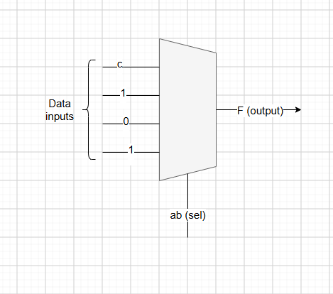
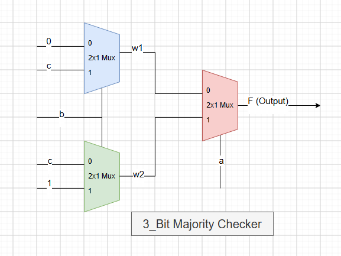
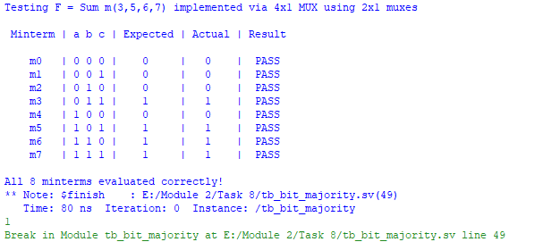
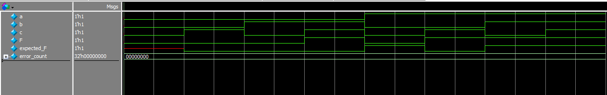

# Task 8: 4-to-1 Multiplexer and 3-Bit Majority Checker

## Overview
This project contains the SystemVerilog RTL design and verification environments for two fundamental combinational logic circuits: a 4-to-1 Multiplexer (MUX) and a 3-Bit Majority Checker. It demonstrates data routing based on selector signals and combinational logic for voting/majority thresholds.

## Directory Structure
*   **`rtl/`**: Contains the SystemVerilog design modules.
    *   `mux_4x1.sv` & `Task _8.sv`: The 4-to-1 multiplexer implementation and top-level wrapper.
    *   `bit_majority.sv`: The 3-bit majority checker implementation.
*   **`tb/`**: Contains the testbench files for functional verification.
    *   `tb.sv`: Stimulus and verification for the multiplexer.
    *   `tb_bit_majority.sv`: Stimulus and verification for the majority checker.
*   **`figures/`**: Contains structural diagrams (`.drawio`, `.png`), hand-drawn truth tables (`.jpeg`), terminal logs, and waveform screenshots[cite: 6].

## Design Architecture

### 1. 4-to-1 Multiplexer (`mux_4x1.sv`)
A data selector circuit that routes one of four input data lines to a single output line based on the value of a 2-bit selection bus.

  **Architecture Diagram:** 
   **Truth Table:** 

### 2. 3-Bit Majority Checker (`bit_majority.sv`)
A combinational circuit that evaluates three distinct inputs and asserts its output high (1) only when a strict majority (two or more) of the input signals are high.

   **Architecture Diagram:** 
   **Truth Table:** 

## Verification & Simulation Results
Both designs are verified using dedicated testbenches that apply exhaustive truth-table sweeps, validating the combinational logic against expected results.

### Terminal Output
The testbenches automatically monitor signal changes and log the expected versus actual behavior to the terminal to confirm functional accuracy.

   **Multiplexer Log:** 
   **Majority Checker Log:** 

### Waveform Analysis
Simulation timing and signal transitions were evaluated using a waveform viewer to ensure correct gate-level propagation and data routing.

   **Multiplexer Waveform:** 
   **Majority Checker Waveform:** 