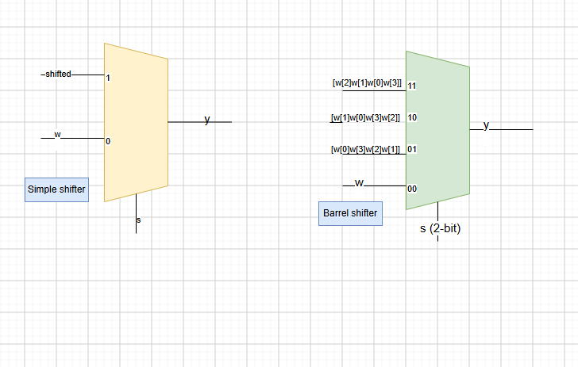
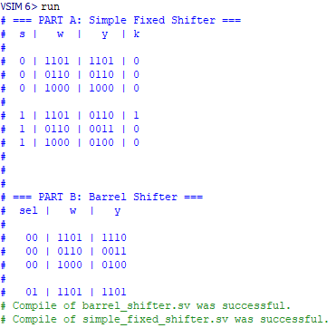
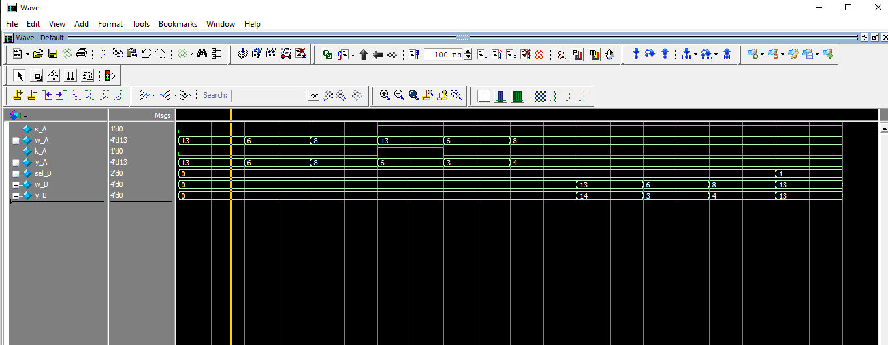

# Task 9: Simple Fixed Shifter and Barrel Shifter

## Overview
This project contains the SystemVerilog RTL design and verification environment for digital shift operations. It explores two distinct approaches: a simple fixed-amount shifter and a dynamic barrel shifter capable of shifting a data word by a variable number of bits within a single combinational logic step.

## Directory Structure
*   **`rtl/`**: Contains the SystemVerilog design modules.
    *   `simple_fixed_shifter.sv`: Implementation of static bitwise shift logic.
    *   `barrel_shifter.sv`: Implementation of a highly optimized, variable-amount barrel shifter (often utilizing cascaded multiplexers or a `unique case` construct).
*   **`tb/`**: Contains the testbench file for functional verification.
    *   `tb_shifters.sv`: A combined stimulus and verification environment for testing both shifter modules.
*   **`figures/`**: Contains structural diagrams (`.drawio`, `.png`), terminal logs, and waveform screenshots[cite: 7].

## Design Architecture

### 1. Simple Fixed Shifter (`simple_fixed_shifter.sv`)
A fundamental combinational circuit that shifts an input vector left or right by a hardcoded or statically defined number of bit positions. 

### 2. Barrel Shifter (`barrel_shifter.sv`)
A more advanced combinational circuit that uses a control signal to determine the shift amount dynamically. Unlike a sequential shifter that takes multiple clock cycles to shift data bit-by-bit, the barrel shifter completes multi-bit shifts (logical or arithmetic) in $O(1)$ time using parallel hardware routing.

**Architecture Diagram:**
  

## Verification & Simulation Results
The testbench (`tb_shifters.sv`) validates both designs by applying various data words and iterating through different shift amounts, ensuring bits are accurately shifted and padded with zeros (or sign-extended) as required.

### Terminal Output
The testbench monitors input permutations and expected shift results, logging the actual behavior to the terminal to confirm arithmetic/logical correctness.

  **Terminal Log:** 

### Waveform Analysis
Simulation timing and signal transitions were evaluated using a waveform viewer to verify immediate, single-cycle combinational propagation for the variable shift operations.

   **Simulation Waveform:** 