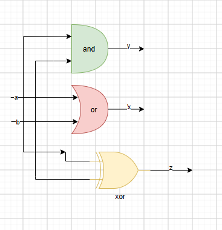
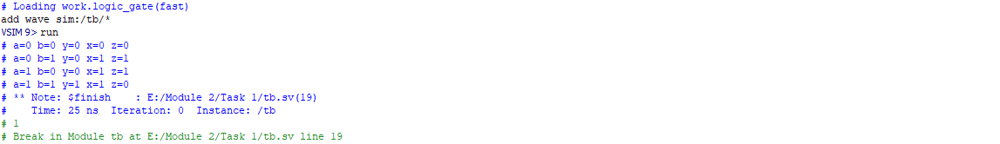
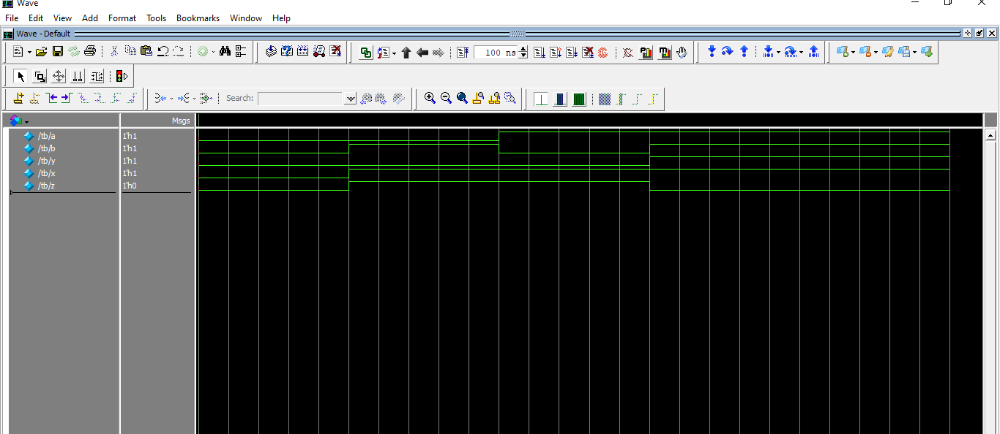

# Task 1: Basic Logic Gate Implementation

## Overview
This project contains the SystemVerilog RTL design and verification environment for fundamental digital logic gates. It serves as an introductory exercise in combinational logic design, stimulus generation, and basic simulation analysis.

## Directory Structure
*   **`rtl/`**: Contains the SystemVerilog design module.
    *   `logic_gate.sv`: The basic logic gate RTL implementation.
*   **`tb/`**: Contains the testbench file for functional verification.
    *   `tb.sv`: Stimulus and verification environment.
*   **`figures/`**: Contains architectural diagrams (`.drawio`, `.png`), terminal logs, and waveform screenshots[cite: 17].

## Design Architecture
The design consists of a single module (`logic_gate.sv`) that implements foundational combinational logic operations (such as AND, OR, and XOR) to compute outputs based on 1-bit binary inputs.

**Architecture Diagram:**
   

## Verification & Simulation Results
The testbench (`tb.sv`) applies a complete truth-table sweep of input vectors to verify the correct combinational behavior of the implemented logic gates. 

### Terminal Output
The testbench automatically monitors the input changes and logs the results to the terminal, confirming that the logic precisely matches the expected truth table.

   **Terminal Log:** 

### Waveform Analysis
Simulation timing and signal transitions were evaluated using a waveform viewer to ensure immediate, correct gate-level propagation of the signals.

   **Simulation Waveform:** 