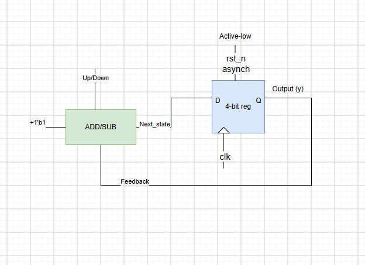
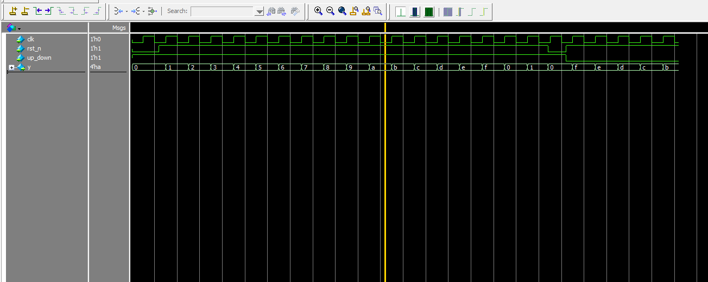

# Task 10: Up/Down Counter Implementation

## Overview
This project contains the SystemVerilog RTL design and verification environment for a digital Up/Down Counter. It marks a transition from purely combinational logic to sequential logic design, utilizing a clock edge and reset signal to manage state transitions and increment/decrement operations over time.

## Directory Structure
*   **`rtl/`**: Contains the SystemVerilog design module.
    *   `up_down_counter.sv`: The sequential up/down counter RTL implementation.
*   **`tb/`**: Contains the testbench file for functional verification.
    *   `tb_up_down_counter.sv`: Stimulus and verification environment.
*   **`figures/`**: Contains the architectural diagrams (`.drawio`, `.png`) and waveform screenshots[cite: 8].

## Design Architecture
The design consists of a single sequential module (`up_down_counter.sv`). Driven by a clock signal, the counter maintains an internal state (register). Depending on the direction control input (up or down), the counter increments or decrements its value on each active clock edge. It also includes reset logic (synchronous or asynchronous) to initialize the counter state.

**Architecture Diagram:**
   

## Verification & Simulation Results
The testbench (`tb_up_down_counter.sv`) verifies the sequential behavior of the counter by generating a clock signal, asserting the reset, and toggling the directional control inputs across multiple clock cycles.

### Waveform Analysis
Simulation timing and state transitions were evaluated using a waveform viewer. The waveform confirms that the counter successfully holds its value, increments, decrements, and properly handles reset conditions precisely on the active clock edges.

   **Simulation Waveform:** 