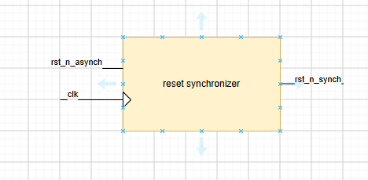

# Task 11: Reset Synchronizer

## Overview
This project contains the SystemVerilog RTL design and verification environment for a Reset Synchronizer. This fundamental sequential circuit ensures that an asynchronous reset signal is safely brought into a synchronous clock domain. It allows the reset to assert asynchronously (immediately) but forces the deassertion to happen synchronously with the clock, preventing metastability and recovery/removal time violations in downstream flip-flops.

## Directory Structure
*   **`rtl/`**: Contains the SystemVerilog design module.
    *   `reset_sync.sv`: The reset synchronizer RTL implementation.
*   **`tb/`**: Contains the testbench file for functional verification.
    *   `tb_reset_sync.sv`: Stimulus and verification environment.
*   **`figures/`**: Contains architectural diagrams (`.drawio`, `.png`, `.jpeg`), terminal logs, and waveform screenshots[cite: 9].

## Design Architecture
The design consists of a single sequential module (`reset_sync.sv`). It typically utilizes a two-flip-flop synchronization chain. The first flip-flop captures the active-low asynchronous reset, and the second flip-flop synchronizes it to the system clock before distributing the stable, synchronized reset signal to the rest of the design.

**Architecture & Schematic Diagrams:**
   
**Manually drawn timing diagrams:**
   

## Verification & Simulation Results
The testbench (`tb_reset_sync.sv`) rigorously tests the synchronization logic by asserting the reset signal independently of the clock edge (asynchronously) and then releasing it to verify synchronous deassertion.

### Terminal Output
The testbench monitors the clock, the raw asynchronous input reset, and the synchronized output reset, logging state changes to the terminal to confirm proper behavior.

   **Terminal Log:** 

### Waveform Analysis
Simulation timing was evaluated using a waveform viewer. The timing diagram visually confirms that while the reset output drops immediately upon the asynchronous input's assertion, the recovery (deassertion) is perfectly aligned with the next active clock edge.

   **Simulation Waveform:** 