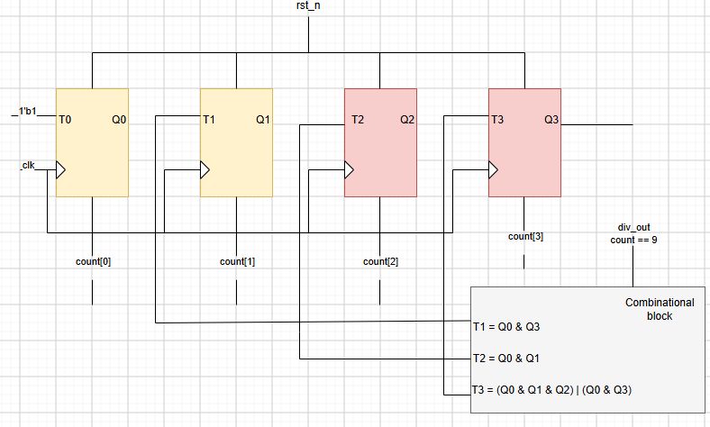
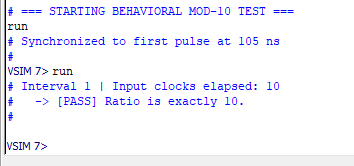
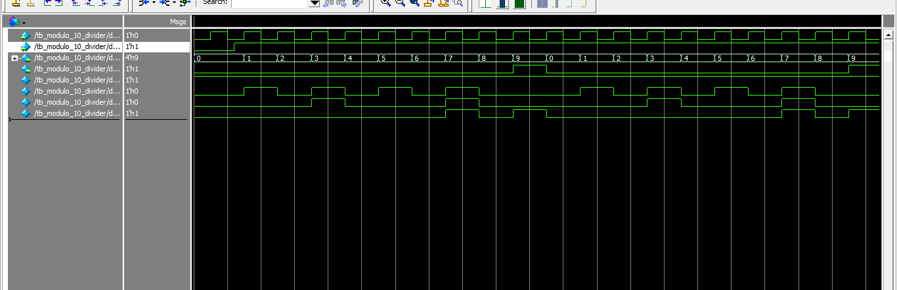

# Task 12: Modulo-10 Frequency Divider

## Overview
This project contains the SystemVerilog RTL design and verification environment for a Modulo-10 Frequency Divider. It serves as an exercise in sequential logic design, utilizing T flip-flops to create a digital counter that divides an input clock frequency by 10 (counting from 0 to 9 before rolling over).

## Directory Structure
*   **`rtl/`**: Contains the SystemVerilog design modules.
    *   `t_ff.sv`: A foundational Toggle (T) flip-flop sub-module.
    *   `modulo_10_divider.sv`: The top-level frequency divider implementation, which instantiates the T flip-flops to construct the mod-10 counting logic.
*   **`tb/`**: Contains the testbench file for functional verification.
    *   `tb_modulo_10_divider.sv`: Stimulus and verification environment.
*   **`figures/`**: Contains architectural diagrams (`.drawio`, `.png`), terminal logs, and waveform screenshots[cite: 10].

## Design Architecture
The design employs a modular hierarchy. The fundamental building block is the T flip-flop (`t_ff.sv`), which toggles its state when its input is high. The top-level module (`modulo_10_divider.sv`) wires multiple T flip-flops together with combinational logic to reset the count upon reaching 10 (binary `1010`), effectively producing an output pulse or toggled clock at one-tenth the frequency of the input clock.

**Architecture Diagram:**
   

## Verification & Simulation Results
The testbench (`tb_modulo_10_divider.sv`) verifies the sequential behavior by generating a continuous input clock and monitoring the counter's internal state and final divided output. 

### Terminal Output
The testbench logs the input clock cycles and the corresponding counter values to the terminal, confirming that the counter properly rolls over after reaching 9.

   **Terminal Log:** 

### Waveform Analysis
Simulation timing was evaluated using a waveform viewer. The timing diagram visually confirms the sequential toggling of the T flip-flops and validates that the output clock period is exactly ten times the duration of the input clock period.

   **Simulation Waveform:** 