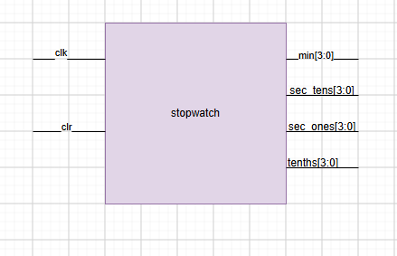

# Task 13: Digital Stopwatch Implementation

## Overview
This project contains the SystemVerilog RTL design and verification environment for a digital stopwatch. It serves as a practical exercise in hierarchical sequential logic design, where multiple smaller counting units are cascaded together to track time accurately.

## Directory Structure
*   **`rtl/`**: Contains the SystemVerilog design modules.
    *   `digit_counter.sv`: A foundational sub-module acting as a single-digit counter (e.g., counting from 0 to 9) with rollover and carry-out logic.
    *   `stopwatch.sv`: The top-level design that instantiates multiple `digit_counter.sv` modules to track higher time units (e.g., milliseconds, seconds, tens of seconds).
*   **`tb/`**: Contains the testbench file for functional verification.
    *   `tb_stopwatch.sv`: Stimulus and verification environment.
*   **`figures/`**: Contains architectural diagrams (`.drawio`, `.png`), terminal logs, and waveform screenshots[cite: 11].

## Design Architecture
The design relies on a modular, cascaded hierarchy. The fundamental building block, `digit_counter.sv`, manages individual time increments and generates an "enable" or "carry" pulse upon reaching its maximum limit. The top-level `stopwatch.sv` wires several of these counters in a chain, ensuring that higher-order digits (like seconds) only increment exactly when the lower-order digits roll over.

**Architecture Diagram:**
   

## Verification & Simulation Results
The testbench (`tb_stopwatch.sv`) verifies the sequential cascading logic by driving a continuous clock signal, asserting start/stop conditions, and monitoring the carry propagation between the chained counters.

### Terminal Output
The testbench logs the elapsed time states to the terminal, confirming that each digit rolls over at the correct threshold (e.g., modulo-10 for single seconds, modulo-6 for tens of seconds) and accurately triggers the next stage in the chain.

   **Terminal Log:** 

### Waveform Analysis
Simulation timing was evaluated using a waveform viewer. The timing diagram visually confirms the sequential increments, the synchronous resets, and the perfectly aligned rollover events across all cascaded counter instances on the active clock edges.

   **Simulation Waveform:** 