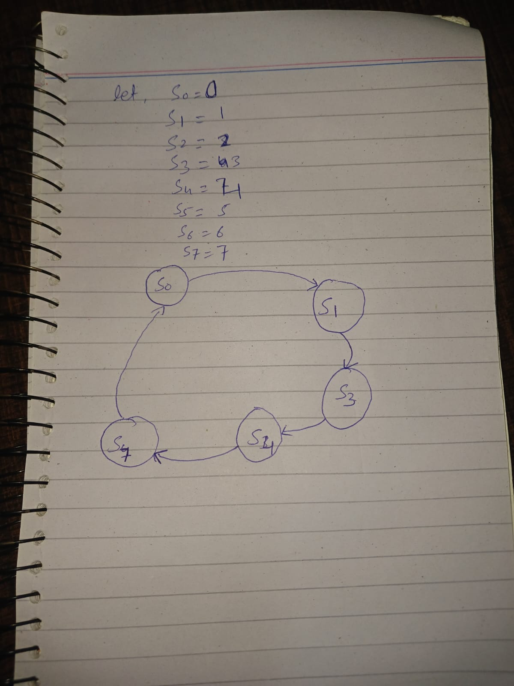
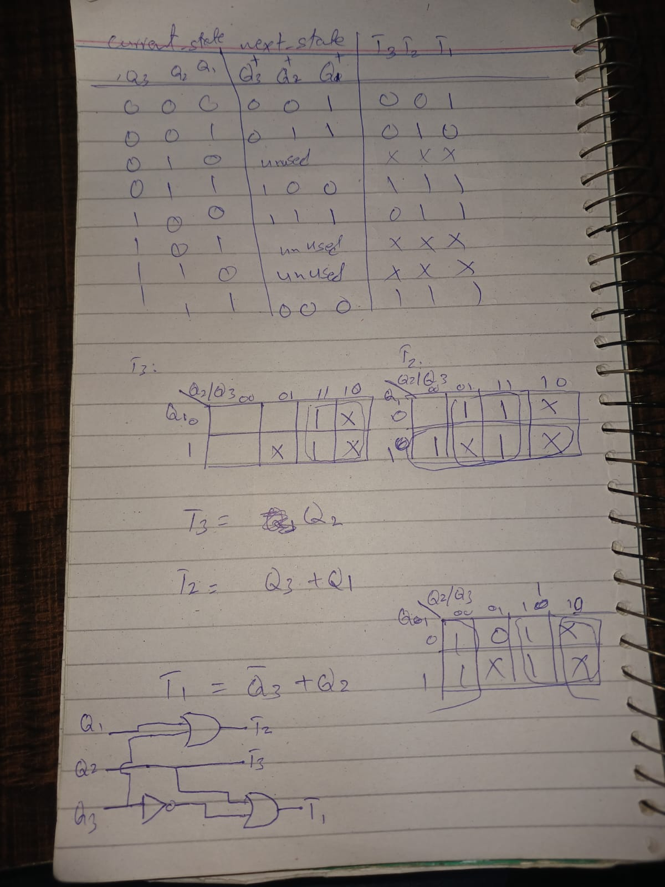
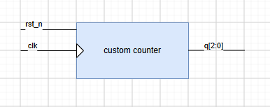

# Task 14: Custom Sequence Counter

## Overview
This project contains the SystemVerilog RTL design and verification environment for a Custom Sequence Counter. It demonstrates the complete workflow for designing a synchronous sequential circuit that transitions through a specific, non-linear sequence of states using Toggle (T) flip-flops and custom combinational excitation logic.

## Directory Structure
*   **`rtl/`**: Contains the SystemVerilog design modules.
    *   `t_ff.sv`: A foundational Toggle (T) flip-flop sub-module.
    *   `seq_counter.sv`: The top-level custom sequence counter implementation, which structurally instantiates the T flip-flops and wires them with the derived excitation logic.
*   **`tb/`**: Contains the testbench file for functional verification.
    *   `tb_custom_counter.sv`: Stimulus and verification environment.
*   **`figures/`**: Contains architectural diagrams (`.drawio`, `.png`), hand-drawn state derivations (`.jpeg`), and waveform screenshots[cite: 12].

## Design Architecture
Designing this custom counter required manually determining the necessary input logic to drive each flip-flop's toggle pin. The state transition logic was mapped out using state diagrams and Karnaugh Maps to derive the optimized Boolean excitation equations for each T flip-flop. The top-level module (`seq_counter.sv`) implements these derived equations to connect the instantiated `t_ff.sv` blocks.

**State Derivation & Architecture Diagrams:**

   
   **State diagram:** 
   
   **Excitation Logic (Part 2):** 

   **Architecture Diagram:** 

## Verification & Simulation Results
The testbench (`tb_custom_counter.sv`) verifies the behavior of the sequential logic by driving a continuous clock signal, applying the reset condition, and monitoring the specific state transitions to ensure the counter does not deviate into invalid states and correctly loops back to the start of the sequence.

### Waveform Analysis
Simulation timing was evaluated using a waveform viewer. The timing diagram visually confirms that the counter successfully navigates the custom counting sequence perfectly aligned to the active clock edges, proving the accuracy of the manually derived excitation equations.

   **Simulation Waveform:** 