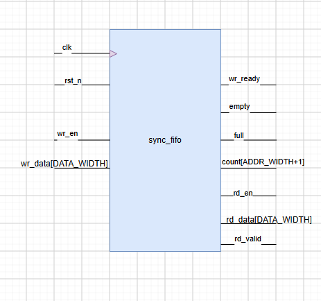

# Task 17: Synchronous FIFO (First-In-First-Out) Buffer

## Overview
This project contains the SystemVerilog RTL design and verification environment for a Synchronous FIFO. A FIFO is a critical sequential data structure used extensively in digital logic to safely buffer data between a producer and a consumer. Because it is synchronous, both read and write operations are governed by the same clock domain.

## Directory Structure
*   **`rtl/`**: Contains the SystemVerilog design module.
    *   `sync_fifo.sv`: The parameterized synchronous FIFO implementation.
*   **`tb/`**: Contains the testbench file for functional verification.
    *   `tb_sync_fifo.sv`: A comprehensive, self-checking testbench to verify FIFO operations and flag assertions.
*   **`figures/`**: Contains architectural diagrams (`.drawio`, `.png`), terminal logs, and waveform screenshots[cite: 15].

## Design Architecture
The design is heavily parameterized (e.g., `DATA_WIDTH` and `ADDR_WIDTH`/`DEPTH`), allowing it to be easily scaled for different applications. It consists of three primary logic components:
1.  **Memory Array:** A 2D register array that stores the buffered data.
2.  **Pointer Logic:** Internal read and write pointers that increment respectively on read and write operations, wrapping around as needed.
3.  **Status Flags:** Combinational or sequential logic that calculates the difference between the pointers to drive boundary flags, ensuring data is never overwritten (via `full`) or read improperly (via `empty`). The design also supports advanced predictive flags like `almost_full` and `almost_empty`.

**Architecture Diagram:**
   

## Verification & Simulation Results
The testbench (`tb_sync_fifo.sv`) rigorously exercises the FIFO by pushing and popping data under various conditions. It utilizes self-checking tasks to ensure no data is lost or corrupted.

### Terminal Output
The testbench logs sequential operations to the terminal, confirming correct behavioral bounds. It explicitly verifies:
*   Writing sequential data until the `full` flag correctly asserts (and prevents overflow).
*   Reading data until the `empty` flag correctly asserts (and prevents underflow).
*   Correct assertion of intermediate predictive flags (`almost_full`, `almost_empty`).
*   Concurrent read and write operations when the FIFO is partially full.

   **Terminal Log:** 

### Waveform Analysis
Simulation timing was evaluated using a waveform viewer. The timing diagram visually confirms the incrementing data pointers, the stable data payload propagation, and the exact clock-edge alignment of the status flags.

   **Simulation Waveform:** 