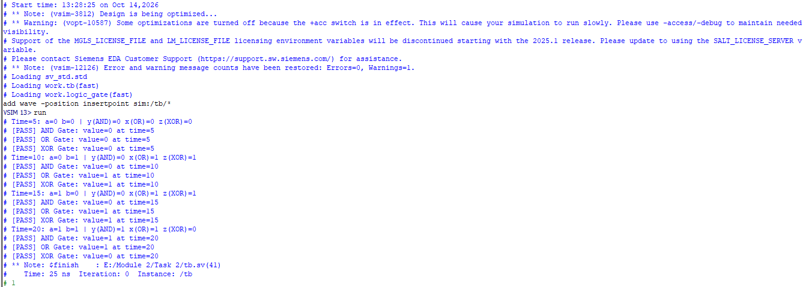
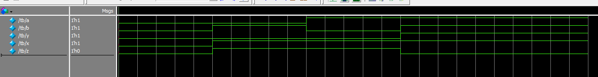

# Task 2: Self-Checking Testbench Implementation

## Overview
This project builds upon the basic logic gate design by upgrading the verification environment into an automated, self-checking testbench. It eliminates the need for manual visual inspection of waveforms by automatically evaluating the Device Under Test (DUT) outputs against expected truth-table values.

## Directory Structure
*   **`rtl/`**: Contains the SystemVerilog design module.
    *   `logic_gate.sv`: The basic combinational logic gate RTL implementation.
*   **`tb/`**: Contains the testbench file for functional verification.
    *   `tb.sv`: The upgraded self-checking stimulus and verification environment.
*   **`figures/`**: Contains terminal logs and waveform screenshots verifying the automated checks[cite: 18].

## Design Architecture
The hardware design (`logic_gate.sv`) remains a fundamental combinational circuit that computes basic bitwise logic operations (e.g., AND, OR, XOR) for given inputs. The architectural focus of this task shifts to the verification environment, utilizing a dedicated checking task within the testbench to enforce strict evaluation (such as catching unexpected `X` or `Z` states using the `!==` operator).

## Verification & Simulation Results
The testbench (`tb.sv`) applies a complete sweep of input vectors. Instead of relying purely on visual timing diagrams, the testbench dynamically calculates expected outputs on the fly and compares them to the actual RTL outputs.

### Terminal Output
The testbench automatically monitors the input changes and logs the evaluation results to the terminal. It outputs a clear `[PASS]` or `[FAIL]` status along with the simulation timestamp for every tested vector.

   **Terminal Log:** 

### Waveform Analysis
Simulation timing and signal transitions were evaluated using a waveform viewer to serve as a secondary, visual confirmation that the signals match the automated terminal reports.

   **Simulation Waveform:** 