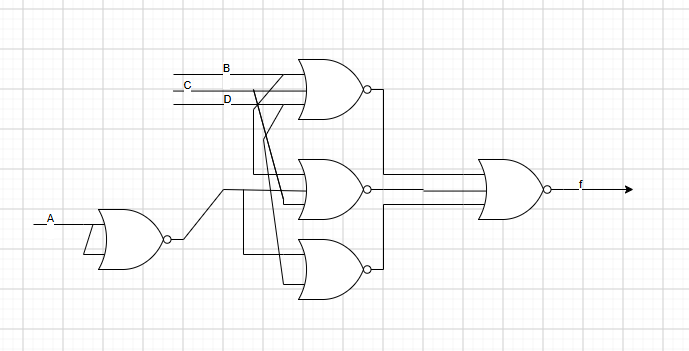

# Task 4: NOR Gate Implementation

## Overview
This project contains the SystemVerilog RTL design and verification environment for a fundamental digital logic NOR gate. It serves as a foundational exercise in combinational logic design, stimulus generation, and simulation analysis.

## Directory Structure
*   **`rtl/`**: Contains the SystemVerilog design module.
    *   `NOR_Gate.sv`: The NOR gate RTL implementation.
*   **`tb/`**: Contains the testbench file for functional verification.
    *   `tb.sv`: Stimulus and verification environment.
*   **`figures/`**: Contains architectural diagrams (`.drawio`, `.png`, `.jpeg`), terminal logs, and waveform screenshots[cite: 2].

## Design Architecture
The design consists of a single module (`NOR_Gate.sv`) that implements standard NOR logic, producing a high (1) output only when all inputs are low (0). 

**Architecture & Schematic Diagrams:**
  

**Boolean algebra for NOR network:**
   

## Verification & Simulation Results
The testbench (`tb.sv`) applies a complete truth table sweep of input vectors to verify the correct combinational behavior of the NOR gate. 

### Terminal Output
The testbench automatically monitors the input changes and logs the results to the terminal to confirm the logic matches the expected truth table.

  **Terminal Log:** 

### Waveform Analysis
Simulation timing and signal transitions were evaluated using a waveform viewer to ensure correct gate-level propagation.

  **Simulation Waveform:** 