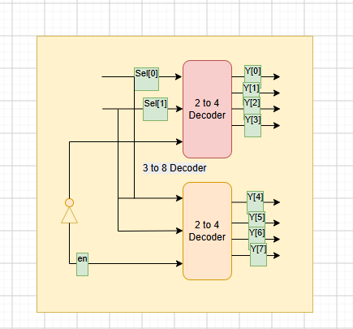

# Task 6: Decoder Implementation

## Overview
This project contains the SystemVerilog RTL design and verification environment for a digital decoder circuit. It serves as a practical exercise in combinational logic design, routing an N-bit input code to assert exactly one of $2^N$ output lines.

## Directory Structure
*   **`rtl/`**: Contains the SystemVerilog design modules.
    *   `dec.sv`: Sub-module / foundational decoder logic.
    *   `Decoder.sv`: Top-level decoder implementation (likely utilizing a hierarchical structure or instantiating `dec.sv`).
*   **`tb/`**: Contains the testbench file for functional verification.
    *   `tb.sv`: Stimulus and verification environment.
*   **`figures/`**: Contains the architectural diagrams (`.drawio`, `.png`), terminal logs, and waveform screenshots[cite: 4].

## Design Architecture
The design is split across two SystemVerilog files (`dec.sv` and `Decoder.sv`), indicating a modular or hierarchical approach (such as constructing a larger 3-to-8 decoder using smaller 2-to-4 decoder blocks). 

**Architecture Diagram:**
  

## Verification & Simulation Results
The testbench (`tb.sv`) applies a comprehensive sweep of input select vectors to verify the correct combinational behavior of the decoder. 

### Terminal Output
The testbench automatically monitors the input changes and logs the results to the terminal to confirm that only the correct corresponding output bit is asserted for each input combination.

  **Terminal Log:** 

### Waveform Analysis
Simulation timing and signal transitions were evaluated using a waveform viewer to ensure accurate gate-level logic propagation and output assertion.

   **Simulation Waveform:** 